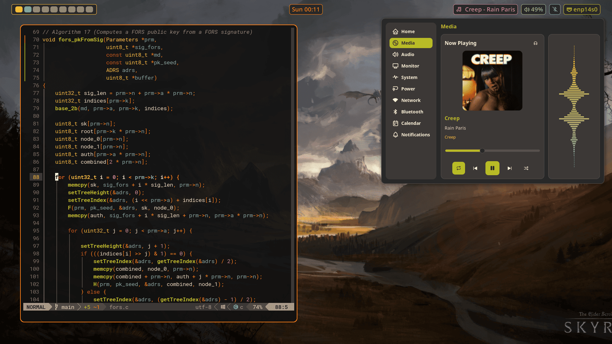

# Welcome ~/

This repository contains my personal Linux dotfiles. \
They are often (speak: all the time) a work in progress and may or may not work for you.




## Dependencies

The list of used packages can be found in `packages.txt` and `packages_AUR.txt`.<br>
To install them, use:

```sh
pacman -S --needed - < packages.txt
yay -S --needed - < packages_AUR.txt
```

To generate the list of packages, run `pacman -Qqn` to get the list main repo packages and `pacman -Qqm` for AUR packages.


## Installation

The script `install.sh` places symlinks to the local repo, so all files can stay in one place.<br>
You might want to ignore that, this is just for my personal setup.

```sh
./install.sh   # or
./install.sh -p /absolute/path/to/dotfiles/
```

There is no wallpaper included, you can set one via Noctalia.

> [!NOTE]
> The `xdg-user-dirs` package is used to get rid of most of the standard XDG directories.
> See the [user-dirs.dirs](./user-dirs.dirs) file for details.


## Configure Neovim Plugins

The keybinds are listed in [init.lua](nvim/init.lua).
Plugins are managed via [Lazy.nvim](https://github.com/folke/lazy.nvim).
The Plugin manager installs itself and all plugins automatically.
LSP clients are installed automatically via [Mason](https://github.com/williamboman/mason.nvim).

The following packages are exteneral dependencies, install them with your package manager:
```
fd ripgrep fzf tree-sitter tree-sitter-cli python-pynvim go unzip
```


## Librewolf

Place the `user.js` file in `~/.config/librewolf/librewolf/*.default-release/` (`install.sh` takes care of that), and restart the browser.

Add the following line to the `My Filters` tab in uBlock Origin to disable the `Sign in with Google` popup.
```
accounts.google.com/gsi/*
```


## Slack Theme

Gruvbox Slack theme. Paste into `Preferences` > `Appearance`.
```
#282828,#D65D0E,#83C07C,#FB4934
```


## Pacman

### Config

Enable the following options and also enable the `extra` and `multilib` repos.
```
Color
CheckSpace
VerbosePkgLists
ParallelDownloads = 5
DownloadUser = alpm
```

### Pacman Hook

Make sure to install the `pacman-contrib` package, then copy the file to `/etc/pacman.d/hooks`.

```sh
sudo mkdir /etc/pacman.d/hooks
sudo cp clear_cache.hook /etc/pacman.d/hooks
```
